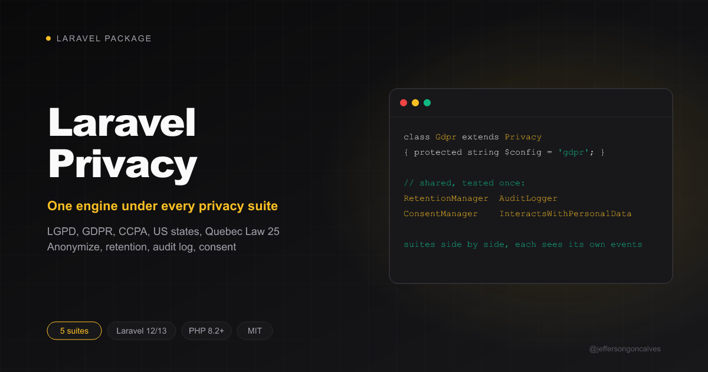

# Laravel Privacy



[](https://packagist.org/packages/jeffersongoncalves/laravel-privacy)
[](https://github.com/jeffersongoncalves/laravel-privacy/actions/workflows/tests.yml)
[](https://packagist.org/packages/jeffersongoncalves/laravel-privacy)

The engine shared by the privacy suites for Laravel. You don't install it on its own: install the suite of your law,
which pulls it in.

| Suite | Law |
|---|---|
| [laravel-lgpd](https://github.com/jeffersongoncalves/laravel-lgpd) | Brazil: LGPD (Lei 13.709/2018) |
| [laravel-gdpr](https://github.com/jeffersongoncalves/laravel-gdpr) | EU: GDPR (Regulation (EU) 2016/679) |
| [laravel-ccpa](https://github.com/jeffersongoncalves/laravel-ccpa) | California: CCPA/CPRA |
| [laravel-us-privacy](https://github.com/jeffersongoncalves/laravel-us-privacy) | The other US state privacy laws |
| [laravel-quebec](https://github.com/jeffersongoncalves/laravel-quebec) | Quebec: Law 25 |

## What it holds

The parts that work the same under every law live here, tested once:

| Part | Classes |
|---|---|
| Personal data declarations | `Attributes\PersonalDataAttribute`, `Contracts\HasPersonalData`, `Concerns\InteractsWithPersonalData`, `Contracts\AnonymizeStrategy` + `Concerns\AppliesAnonymizeStrategy` |
| Inventory and k-anonymity | `Privacy`, `Generalize`, `Commands\InventoryCommand`, `Commands\KAnonymityCommand` |
| Retention | `Retention\RetentionManager`, `Retention\Tombstone`, `Retention\Listeners\RecordTombstones`, the retention commands |
| Audit log | `AuditLog\AuditLogger`, `AuditLog\AuditLog`, `AuditLog\Concerns\AuditsPersonalData`, `AuditLog\Commands\VerifyCommand` |
| Consent ledger | `Consent\ConsentManager`, `Consent\ConsentRecord`, `Consent\Concerns\HasConsents`, `Consent\ConsentController` |

What depends on the law stays in each suite: the `#[PersonalData]` attribute and its enums (data categories, legal
bases, flags such as `sold` or `outsideQuebec`), the requests and their deadlines, incidents, vendors, minors, notices.

## Suites side by side

Each suite subclasses these classes and names its own config, tables, attribute and events. A model declared with
`JeffersonGoncalves\Gdpr\Attributes\PersonalData` is only seen by the GDPR suite, and its anonymization fires
`JeffersonGoncalves\Gdpr\Events\PersonalDataAnonymized`, which only the GDPR retention and audit log listen to. So
an app serving Brazil and Europe can install the LGPD and GDPR suites together.

## Building a suite

A suite's classes are thin subclasses. The main class names its config file:

```php
use JeffersonGoncalves\Privacy\Privacy;

class Gdpr extends Privacy
{
    protected string $config = 'gdpr';                       // gdpr.models, gdpr.hash_key

    protected string $contract = HasPersonalData::class;     // the suite's contract (extends the core one)
}
```

The attribute extends `PersonalDataAttribute` and fills `column`, `retention` and `anonymize`. Property types are
invariant, so it takes its `AnonymizeStrategy` enum as a plain parameter and assigns it:

```php
#[Attribute(Attribute::TARGET_CLASS | Attribute::IS_REPEATABLE)]
final class PersonalData extends PersonalDataAttribute
{
    public function __construct(
        public string $column,
        public DataCategory $category = DataCategory::Personal,
        public ?string $retention = null,
        AnonymizeStrategy $anonymize = AnonymizeStrategy::Nullify,
    ) {
        $this->anonymize = $anonymize;
    }

    public function toArray(): array { /* the inventory row */ }
}

enum AnonymizeStrategy: string implements \JeffersonGoncalves\Privacy\Contracts\AnonymizeStrategy
{
    use \JeffersonGoncalves\Privacy\Concerns\AppliesAnonymizeStrategy;

    const HASH_KEY = 'gdpr.hash_key';

    case Nullify = 'nullify';
    case Hash = 'hash';
    case Mask = 'mask';
    case Keep = 'keep';
}
```

The traits name the suite's attribute, event, logger or manager through abstract static methods
(`personalDataAttribute()`, `personalDataAnonymizedEvent()`, `auditLogger()`, `consentManager()`,
`consentRecordModel()`), and the engine classes take their config key and models as properties
(`RetentionManager::$config` / `$tombstone`, `AuditLogger::$config` / `$model`, `ConsentManager::$config` / `$model` /
`$event`, `ConsentRecord::$actionEnum`). See any of the suites above for the full set.

## Testing

```bash
composer test
```

## Changelog

See [CHANGELOG](CHANGELOG.md).

## License

The MIT License (MIT). See [License File](LICENSE.md).
